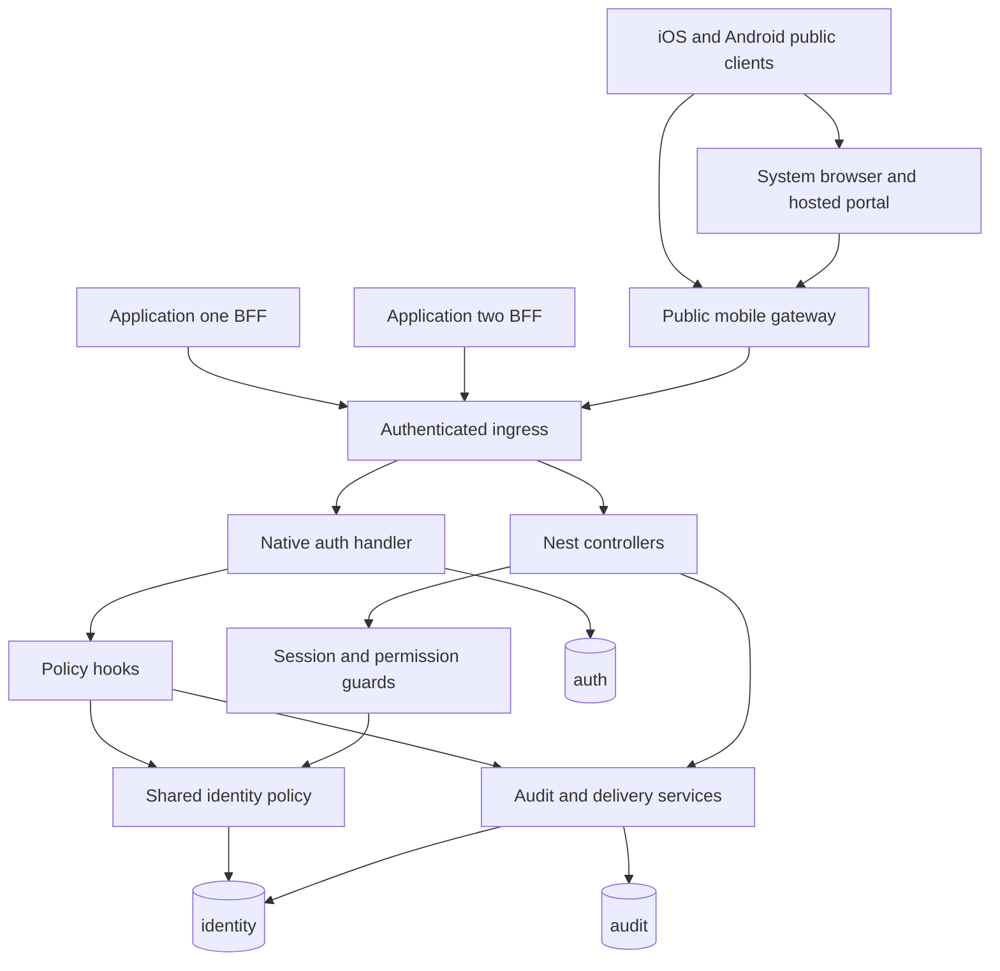

# Authentication and Identity System Design

Status: proposed. Last reviewed: 2026-10-15. Release classification: first-release architecture. Audience: backend implementers and architecture reviewers. Ownership and reviewer names have not been supplied.

[Documentation index](../README.md)

## Objective and scope

Provide one reusable identity backend over HTTP for approved first-party web and native iOS/Android applications. The complete first release includes both platforms, every README authentication method, and operational safeguards. Native desktop authentication remains future work. The system is an identity service, not an application business-data service.

This document adapts the selected System Design reference's twelve-part design structure to Markdown. Other numbered documents expand the implementation specification. No application features have been implemented by this documentation task.

## 1 Abstract

NestJS composes Better Auth through the selected `@thallesp/nestjs-better-auth` AuthModule/AuthService integration, alongside PostgreSQL persistence, SMTP delivery, access policy, and audit infrastructure. The library owns the native handler/session integration; the service adds its application/assurance policy. Better Auth remains the sole authority for passwords, native authentication challenges, accounts, sessions, and federation protocol verification. TypeORM persists service-specific application access, assurance state, delivery jobs, and audit records.

The critical invariant is that a native session identifies a user but is insufficient on its own to authorize an application request. The service also checks the authenticated application, active membership, account restrictions, and any mandatory MFA or bootstrap requirements. Missing policy state fails closed.

## 2 Goals and non-goals

| Goals | Non-goals for release one |
| --- | --- |
| Every listed README feature has an implementable contract and acceptance gate | Implementing these features during this documentation task |
| Reusable first-party HTTP integration and shared user identities | Automatically sharing cookies or sign-in across unrelated domains |
| Web and native iOS/Android authentication through the same identity, MFA, and application policy | Native desktop authentication or selecting/implementing a mobile application framework |
| Inbound enterprise OIDC and SAML federation | Operating an OAuth/OIDC authorization server |
| Strong session revocation and MFA enforcement across all sign-in methods | Stateless JWT sessions or a second refresh-token system |
| Separate PostgreSQL ownership boundaries and controlled migrations | Per-tenant databases or independent credential realms |
| SMTP-only email delivery without provider SDKs/frameworks | Providing an email hosting platform or promising inbox delivery |

## 3 Background and problem statement

The repository README describes a target service. The inspected source is an incomplete scaffold, not an existing identity system.

| Observed state | Design implication |
| --- | --- |
| Better Auth is absent from the manifest and installed package inventory | Add it only in future implementation; do not describe authentication as operational |
| `AppModule` imports absent `app.controller` and `app.service`, and imports no modules | Repair root composition before feature work; compilation was not run |
| Configuration is initialized inside a database module that the root does not import | Establish one root configuration boundary and shared validation |
| Runtime database configuration and CLI data source duplicate options and use empty entity arrays | Reuse both entrypoints through one configuration contract and explicit registrations |
| Both database configurations specify `public` and disable certificate validation when SSL is enabled | Move ownership to dedicated schemas and verified TLS |
| `BaseEntity` uses UUIDv7, timestamps, optimistic versioning, and soft deletion | Reuse selectively for custom mutable records; do not subclass native authentication tables |
| Response DTO uses `status`; transform interceptor emits `statusCode` | Standardize custom HTTP contracts without wrapping Better Auth |
| Error interceptor writes the response and rethrows | Replace terminal error ownership during later implementation to prevent duplicate writes |
| Logging includes the original URL | Remove challenge, callback, and query secrets from logs |
| Bootstrap configures 50 MB JSON and form parsers | Set small route limits and mount the native handler before parsing |
| Swagger advertises JWT and treats `x-app-id` as an API key | Describe actual cookie and service-credential schemes instead |
| Environment example anticipates BFF keys and Redis | Preserve intent, replace plaintext service-key configuration through a controlled cutover; Redis stays optional |
| Docker uses floating pnpm and broadly permits dependency build scripts | Pin tooling and review build-script allowlists during deployment work |
| The existing e2e test expects a scaffold root response | Replace its assumptions in the future testing phase |

Local evidence: repository root README, package manifest/lockfile, `src/main.ts`, `src/app.module.ts`, existing `src/database` and `src/common`, `.env.example`, Dockerfile, Makefile, and existing test configuration. Source/configuration is unchanged by this task.

## 4 Proposed architecture

### Components and interactions

| Component | Responsibility | Storage and failure behavior |
| --- | --- | --- |
| Root composition and config | Validated startup, provider lifecycle, graceful shutdown | No new store; invalid production settings prevent startup |
| Better Auth integration | Native authentication handler and typed server API | `auth`; database failure denies authentication |
| Identity policy | App binding, membership, lifecycle, MFA assurance | `identity`; missing or unavailable state denies access |
| Admin orchestration | Guarded operations through native admin APIs | `auth` plus `identity`; partial work is tracked and retried |
| Mail delivery | Callback-to-job boundary and SMTP dispatch | `identity.email_deliveries`; bounded retries, expiry, no inline SMTP dependency for existing sessions |
| Audit writer | Structured security evidence and privileged-operation evidence | `audit`; privileged operations require durable intent; telemetry records delivery gaps |
| Integration API | Backend session validation and application authorization | Reads authoritative auth and identity stores; no success cache initially |
| Public mobile gateway and hosted portal | Public-client transaction and PKCE binding; system-browser authentication; server-only session handoff | Server-held backend credential; short-lived transaction state in `identity`; native one-time tokens in `auth`; failure never grants access |
| Operations | Health, metrics, rollout and restore procedures | External telemetry; telemetry failures do not bypass policy |

Keep modules inside the current repository and deploy one backend service initially, with separate public gateway and private backend trust boundaries. The mobile gateway may be composed into the same deployment with route and network separation, but its server-held backend credential is never delivered to a mobile app. Reusability means stable HTTP contracts and reusable module boundaries; publishing an npm package, splitting microservices, or adding a message broker is not required.

## 5 Request lifecycle

1. A web browser calls its same-origin BFF. A native mobile app instead calls the public mobile gateway and opens the hosted first-party portal in iOS ASWebAuthenticationSession or Android Custom Tabs. Mobile public clients never supply a service key. The BFF/gateway replaces spoofable headers and attaches its server-held credential for private-backend calls.
2. The private ingress authenticates the BFF or gateway, binds it to an approved application and public host, validates request size, and establishes a request ID. The gateway separately validates its public client's transaction, PKCE challenge, and allowlisted verified HTTPS return link.
3. The Better Auth route policy or Nest guards reject disallowed paths, origins, missing sessions, banned accounts, or unavailable policy state.
4. Better Auth processes credentials or a provider callback. A credential MFA flow may produce only a native pending challenge. A non-credential flow can produce a native session that remains service-pending until a second factor succeeds.
5. The shared policy checks application membership, bootstrap requirements, assurance epochs, and permissions before protected operations. No browser-supplied role or MFA flag is trusted.
6. Persist required state and security evidence. Queue email through callbacks. Distinguish native transactions from independent TypeORM transactions.
7. Return native authentication responses unchanged, or the service-owned envelope for Nest APIs. Forward every `Set-Cookie` separately. Emit redacted operational signals.

For mobile, every sign-in method and enrolled MFA completes in the hosted browser. Only a fully assured, application-authorized session may issue a server-only native one-time token (hashed, one-minute lifetime) for a PKCE S256-bound handoff over a verified Universal Link/App Link. The device exchanges the handoff through the gateway and stores the native signed opaque bearer session in Keychain/Keystore; raw session tokens never enter URLs. Subsequent gateway requests enforce the same authoritative session, app access, and assurance checks as web. See [mobile authentication](../14-mobile-authentication/README.md) for the complete transaction and renewal contract.

## 6 API and data contracts

| Boundary | Owner | Contract |
| --- | --- | --- |
| `/api/auth/*` | Better Auth with custom policy hooks | Library methods, fields, cookies, and redirect/error behavior; explicit exposed-route allowlist |
| `/api/v1/*` | Nest | Authenticated account views, app administration, guarded SSO administration, and audit access |
| `/internal/v1/*` | Nest | Service-authenticated session validation and application authorization; never browser-proxied |
| Public gateway mobile routes | First-party gateway | Public-client transaction, browser completion, one-time-token exchange, and bearer session forwarding; exact routes and fields in the [mobile contract](../14-mobile-authentication/README.md#api-contracts) |
| `/health/live`, `/health/ready` | Nest operations | Restricted health contracts, described in 16 |

The common custom envelope and shared types are defined in [02](../02-common-infrastructure/README.md). Native endpoint contracts are in 06 through 12. Integration and service key contracts are in [13](../13-application-and-service-integration/README.md).

### Database design and ownership

`auth` contains the native user, account, session, verification, and enabled plugin tables, including native one-time handoff verification. `identity` contains applications, memberships, per-session assurance, mobile gateway transactions, account policy, delivery jobs, and administrative operation state. `audit` contains append-oriented security events. Detailed fields, constraints, and migration ownership are in [03](../03-database-and-persistence/README.md) and the linked mobile contract.

The same PostgreSQL database does not make independent pools participate in one transaction. Do not claim atomicity between Better Auth changes, TypeORM state, and SMTP.

## 7 Consistency idempotency and replay

| Scenario | Required behavior |
| --- | --- |
| Duplicate sign-up or email challenge | Non-enumerating response where configured; native challenge rules remain authoritative |
| Concurrent token or recovery-code use | Only the native verification winner succeeds; service assurance cannot be set by a failed response |
| Native write succeeds but policy write fails | Protected access stays denied; retry or reconciliation recovers state |
| SMTP accepted mail but worker crashed | Duplicate delivery is possible; the same challenge is sent and remains single use |
| BFF retries an unsafe operation | Only documented idempotent custom mutations can replay a stored result; do not retry token redemption automatically |
| Concurrent mobile handoff, PKCE mismatch, or expired token | Consume native handoff once; verify the gateway transaction and PKCE before token redemption; reject mismatches and expire state without issuing a bearer session |
| Account permissions or MFA policy changes | An account security epoch invalidates previous assurance; each request reads current policy |
| Role mutation partially completes | Durable operation intent records actual progress; reconcile before reporting completion |

## 8 Security and privacy considerations

Use TLS with certificate verification, exact application host/origin binding, host-only secure cookies, CSRF protection, bounded request sizes, and native plus service-level throttling. Keep the auth backend privately reachable behind authenticated BFFs and the mobile gateway; provider callbacks remain browser-accessible through registered first-party paths. Public mobile endpoints enforce rate limits and transaction binding, rather than trusting an app-embedded service credential.

Use platform system browsers instead of embedded WebViews, verified HTTPS Universal Links/App Links instead of open redirect targets, and Keychain/Keystore-backed bearer storage. Require signed native bearer validation (`requireSignature: true`), with no raw session token in URLs, application logs, or analytics. A signed opaque bearer is a database session credential, not a stateless JWT. Mobile handoff never upgrades a pending MFA session.

Enforce MFA on all sign-in methods for enrolled users. Pending sessions cannot reveal an enrolled TOTP secret, regenerate recovery codes, register a passkey, change credentials, or invoke administration. Require TOTP enrollment for SuperAdmins before normal use. Retain the native password hash implementation unless a separately reviewed migration requires a change.

Do not log passwords, session cookies/tokens, OTPs, email links, authorization codes, assertions, TOTP URIs, recovery codes, or mail payloads. Proposed retention and deletion rules appear in 04 and 15; they are engineering defaults and not a statement of legal obligations.

## 9 Operational readiness

Deployment is container-based on the existing Docker foundation. Provision PostgreSQL, an SMTP relay, the public mobile gateway/hosted portal, and verified iOS/Android HTTPS app-link associations; Redis, Kubernetes, and a message broker are not prerequisites. Keep provider registration, real-device mobile acceptance, backup restoration, certificate/secret rotation, audit evidence, and staged rollout in launch acceptance.

Proposed initial service objective: 99.9% monthly availability for service-owned validation endpoints, measured separately from invalid credentials and external IdP failures. Proposed healthy-dependency validation latency target: p95 under 200 ms at the deployment's explicitly measured workload. These are targets to validate, not measured performance or sizing promises. See [16](../16-deployment-and-operations/README.md).

## 10 Alternatives considered

| Alternative | Decision |
| --- | --- |
| Community TypeORM adapter for all authentication tables | Not selected; use the supported PostgreSQL path and explicit ownership instead |
| Hand-written Nest credential/session/token implementation | Not selected; duplicates Better Auth and increases security maintenance |
| Manually mounted Better Auth Node handler | Superseded by the user's selected `@thallesp/nestjs-better-auth` integration. Use its AuthModule/AuthService and single handler, retaining service-owned ingress, application/assurance policy, and composite guards |
| Native admin plugin alone for all authorization | Insufficient for per-application membership and all-method assurance; reuse its global account operations |
| Redis-backed sessions from day one | Deferred; authoritative database sessions simplify revocation and recovery |
| SMTP provider SDK or Nest mail framework | Excluded by the user's requirement; Nodemailer transport is explicitly allowed |
| Shared parent-domain session cookies | Disabled; avoid unnecessary cross-application cookie exposure |
| Service key embedded in a mobile app | Excluded; native apps are public clients and the gateway retains the backend key |
| Embedded mobile login WebView or independent mobile JWT issuer | Excluded; use the platform system browser and native signed opaque bearer sessions with common revocation/MFA policy |

## 11 Assumptions and open deployment inputs

Confirmed architecture decisions appear in the index and must not be reopened by an implementer. The following are deployment inputs, not unresolved architecture choices: actual first-party hosts/common RP domain, hosted portal/gateway host, approved iOS bundle/team and Android package/signing-certificate identifiers, verified app-link association files, SMTP relay/sender and credentials, Google client registrations, enterprise IdP metadata/certificates, PostgreSQL endpoint/CA, secret manager, monitoring destination, owner contacts, and measured traffic envelope.

Fail startup or disable the relevant externally configured provider when an essential input is missing. Never insert fabricated credentials, broadly trusted wildcard hosts, or silent insecure fallbacks. A first-release acceptance environment must supply every required README provider/method before release approval.

## 12 Decision and next steps

### Dependencies and prerequisites

Read [01](../01-dependencies-and-compatibility/README.md), then follow M0 through M5 in the [master roadmap](../README.md). Security policy and schema contracts precede identity feature implementation. The testing strategy supplies incremental verification gates throughout.

### Implementation plan

1. Record the current source baseline and accepted decisions.
2. Establish the package/module-format baseline without replacing the repository architecture.
3. Repair composition, then implement database/security/mail foundations.
4. Add core identity and sessions; complete administration and all-method MFA.
5. Add passwordless, Google, passkeys, and enterprise federation using the same policy boundary.
6. Complete web BFF and native mobile gateway/system-browser integration; obtain real iOS/Android handoff, storage, MFA, revocation, recovery, and rollout evidence before release.

### Acceptance criteria

- ARCH-01: Every README capability maps to one phase, one owner, and measurable acceptance IDs.
- ARCH-02: Diagrams, schemas, route boundaries, and the master roadmap agree.
- ARCH-03: Native and custom responsibilities are separated without a duplicate credential/challenge/session subsystem.
- ARCH-04: Required deployment inputs and unverified runtime assumptions are explicitly recorded.
- ARCH-05: Complete release approval requires M5; incomplete milestones cannot be presented as the finished first release.
- ARCH-06: Web and native iOS/Android authentication, every supported sign-in method, enrolled MFA, secure session handling, and application-specific access all pass first-release gates; desktop remains deferred.

## Official references

- [Better Auth introduction](https://better-auth.com/docs/introduction)
- [Express integration](https://better-auth.com/docs/integrations/express)
- [PostgreSQL integration](https://better-auth.com/docs/adapters/postgresql)
- [Community adapters](https://better-auth.com/docs/adapters/community-adapters)
- [Nest modules](https://docs.nestjs.com/modules)
- [Nest TypeORM integration](https://docs.nestjs.com/data/typeorm)
- [Better Auth bearer sessions](https://better-auth.com/docs/plugins/bearer)
- [Better Auth one-time tokens](https://better-auth.com/docs/plugins/one-time-token)
