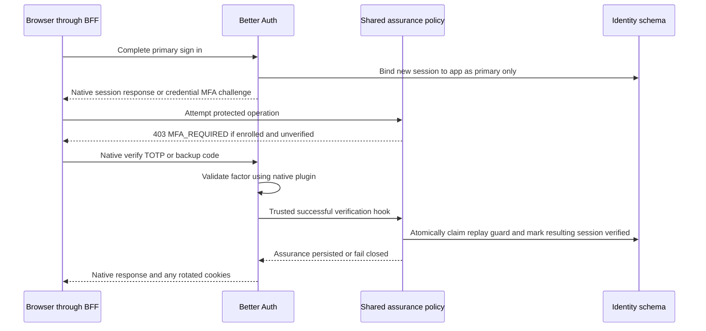

# Multi Factor Authentication and Session Assurance

Release classification: first-release requirement, M3. Last reviewed: 2026-10-15.

[Documentation index](../README.md) · Prerequisites: [Security](../04-security-and-audit-foundations/README.md), [Sessions](../07-session-management/README.md), [Authorization](../08-authorization-and-bootstrap/README.md)

## Objective and scope

Provide native TOTP enrollment and recovery codes, with mandatory second-factor completion after every sign-in method for users who enable MFA. SuperAdmins must enroll before normal access. Password, username, magic link, email OTP, Google, passkey, and enterprise SSO all obey the same service policy.

The first release uses authenticator-app TOTP and recovery codes as second factors. Email OTP is a primary sign-in method, not a second factor after another email-based method. Native trusted-device bypass and email/SMS-based second-factor delivery are disabled. A passkey or an IdP claim of MFA does not replace the enrolled factor under the user's selected policy.

This applies to web and native iOS/Android authentication in the first release. Mobile primary authentication, enrollment/setup, and factor completion run in the hosted system browser on the approved first-party authentication origin. The [mobile handoff](../14-mobile-authentication/README.md) transfers only a fully authorized session to the app; it never transfers a native credential challenge or MFA-pending session.

## Architecture and design

### Native and custom responsibilities

Better Auth's two-factor plugin owns secrets, enrollment, algorithmic verification, recovery-code storage/consumption, and native credential sign-in challenges. Configure TOTP, verified enrollment, passwordless-account enrollment support, encrypted backup-code storage, and a stable issuer. Do not implement TOTP cryptography or a second backup-code store.

The native plugin challenges credential sign-ins by default; it does not automatically challenge magic links, email OTP, OAuth/social, passkeys, or SSO. The service therefore owns assurance beyond the native session. Enforcement runs both in the explicit Nest composite guard (bridge `AuthGuard` followed by identity/assurance policy) and in Better Auth request hooks; bridge-mounted native Express routes do not pass through Nest controller guards. The bridge middleware establishes caller/route context, and native server API wrappers use the same policy. Bridge roles, decorators, and raw session presence do not establish verified MFA.

Versioned source confirms native verification also supports re-verification of an existing session. This is the path for non-credential sign-ins: retain their native session as a primary-verified, restricted session, then call the native TOTP or backup-code endpoint. Do not manufacture the library's signed pending cookie or use undocumented internal challenge creation functions.

### State model

| State | Meaning | Allowed operations |
| --- | --- | --- |
| Native credential challenge | Password accepted; native plugin has not issued a usable session | Native TOTP/backup verification and explicit challenge restart; no custom account reads |
| `primary_only` | Native session exists, bound to one app, but enrolled MFA is incomplete | Token-free policy status, factor verification, sign-out, explicitly allowed session termination |
| `verified` | Native session, current app binding, current security epoch, and MFA success agree | Ordinary authorized operations; privileged actions additionally require recent MFA |
| Enrollment required | Bootstrap account has verified its primary identity but has not completed required setup | Only next permitted password-change/enrollment actions and sign-out |
| Expired or stale assurance | Pending TTL elapsed, policy epoch changed, account restricted, or native session ended | Deny protected access; require a new primary sign-in when epoch/session is stale |

For users without MFA, a valid bound `primary_only` session can satisfy ordinary account access if bootstrap/lifecycle policy permits; the five-minute pending-factor expiry does not truncate an ordinary non-MFA session. For MFA-enabled users, primary-only state cannot satisfy access. State names never substitute for checking the user's current native MFA flag and security policy.

Missing assurance, app mismatch, or missing account policy is a denial. Session age or a successful provider callback cannot infer verified assurance. Native `/get-session` remains informational and is never an application authorization decision.

For mobile, both one-time-token generation and exchange re-evaluate the resulting native session, application, epoch, lifecycle, and factor policy. MFA-enabled users must have `verified` assurance before either step releases credentials. Native one-time-token verification refers to the same native session; it does not establish a new primary identity, reset session expiry, mark another session verified, or refresh `mfa_verified_at`. Cookie and signed bearer resolution must retrieve that same assurance through the shared policy service. A mobile UI's factor-complete flag or cached profile cannot authorize access.

### Enforcement boundary

Use one policy service from both native before/after hooks and Nest guards. The before hook classifies exact native paths and denies unlisted or forbidden operations; do not inspect only the response redirect. The after hook recognizes successful native factor verification from trusted server context and records assurance before returning success to the caller.

Pending enrolled users must not access `/two-factor/get-totp-uri`, `/two-factor/enable`, `/two-factor/disable`, recovery-code generation, passkey registration, account linking/unlinking, profile/email/password mutation, deletion, native admin methods, SSO administration, or service-key creation. Knowing the primary password must not reveal an already-enrolled second-factor secret. Enrollment exceptions apply only when the native factor is genuinely unverified and the user's bootstrap/setup state authorizes enrollment.

Pending and setup-restricted sessions also cannot call mobile handoff generation/exchange or obtain a bearer credential from a native response header. Native one-time-token HTTP generate/verify routes remain denied; only the trusted mobile orchestration wrapper can invoke their server APIs after full policy checks. The pinned one-time-token plugin disables automatic issuance headers and client generation. Do not expose primary sign-in or factor-verification response tokens directly to a native app outside this completed-browser handoff.

Native server API administration is invoked only through a trusted in-process operation capability established after the service-owned guards. A header, DTO field, or URL parameter cannot grant that capability. The same policy rejects direct public native routes that would bypass orchestration.

### Completion and rotation

1. Native session creation starts with an app-bound `primary_only` assurance record. Read current account security epoch; never accept an app ID or epoch from the browser. A missing binding remains denied if that independent write fails.
2. Native credential sign-in may create then discard an intermediate session. Its orphan assurance record grants nothing because native lookup fails. Clean it later; null-check `newSession` in hooks.
3. Bind a native pending credential challenge to its authenticated BFF application using a short-lived HMAC reference in `identity.auth_flow_bindings`. Fail closed if the flow's application cannot be established.
4. On successful native TOTP/backup verification, resolve the actual resulting session from trusted response/session context. Enrollment and other native operations can rotate a session; do not elevate the old `ctx.session` blindly or infer success from HTTP status alone.
5. Within one identity transaction, lock current account policy, recheck lifecycle/epoch/app binding and pending expiry, claim the TOTP replay guard when applicable, and mark only that session verified. Store factor method and UTC verification time. Carry the original primary method/provider/subject-binding context through factor completion and any session rotation from the trusted prior flow/session; do not replace an SSO primary source with `totp` and lose its current trust checks. The native operation and this transaction are not one transaction.
6. If persistence fails after native success, leave the session restricted. The response reports failure; no authorization consumer trusts the native session alone. A consumed recovery code may need replacement with another code. Require a fresh TOTP if replay has already been claimed.

### Freshness and policy changes

Each new sign-in requires its own factor completion. An existing verified session remains ordinarily usable until native expiry/revocation or security-epoch change. Administrative operations and credential/factor management require verification within five minutes as well as native freshness wherever required. Re-verifying TOTP updates that session's `mfa_verified_at`; it does not alter native `createdAt` or waive native fresh-session checks. If native freshness is expired, sign in again.

An app returning to the foreground resolves the signed bearer session against current server policy before protected use. Handoff and OS secure storage do not extend either freshness clock. When fresh authentication or factor proof is required, return through the hosted system-browser flow; an offline or cached app state grants no protected capability.

Enabling/disabling MFA, regenerating recovery codes, resetting factors, credential recovery, role changes, and administrative restrictions increment the account security epoch under serialized policy mutation. Previously bound sessions cannot inherit the new epoch. Enrollment completion sets the resulting new session to the new epoch only after verified native enrollment; other sessions must sign in again.

MFA disabling requires the current enrolled factor and recent assurance; credential users also satisfy the native password requirement. A SuperAdmin cannot disable its required factor. Users who lose both authenticator and recovery codes cannot recover MFA using only an email reset link; assisted recovery is a separately controlled future procedure, not a first-release email bypass.

## Dependencies and prerequisites

Use `twoFactor` from `better-auth/plugins`. Use the native client plugin when an application integrates the flow; frontend implementation is outside this backend task. No independent OTP/TOTP package is needed.

Prerequisites are native sessions, application binding, account policy, verified SMTP-based registration/recovery, audit, and atomic abuse counters. Before enabling passwordless/social/federated methods, include their session-creation/completion paths in the same integration coverage. Their feature flags cannot be enabled while MFA enforcement for those paths is absent.

## Database design

Native factor records and `user.twoFactorEnabled` remain in `auth`. Their exact versioned schema comes from the selected plugin configuration. Never expose their secret or backup-code ciphertext through TypeORM identity APIs.

`identity.session_assurance` stores `session_id` (opaque text PK), `user_id`, `application_id`, `security_epoch`, `state`, `primary_method`, optional `mfa_method`, `mfa_verified_at`, `pending_expires_at`, creation/update timestamps, and a version. Index user/app and expiry. `mfa_method` is `totp` or `recovery_code` when verified. Pending verification expires five minutes after primary completion; native credential challenge lifetime is configured to the same five-minute policy.

`identity.account_policies` holds the current security epoch and bootstrap/lifecycle restrictions. `identity.auth_flow_bindings` associates native pending flow references with the app and expiry; it stores no native challenge token or second-factor secret.

`identity.mfa_replay_claims` stores `user_id`, keyed HMAC `code_fingerprint`, and `expires_at`, unique by user/fingerprint. Claim an accepted TOTP atomically after native success and before granting assurance. Retain it for 90 seconds, covering the accepted adjacent time windows. An expired claim can be replaced atomically. Do not store the six-digit code, try to recover the native secret, or build another TOTP verifier. Apply a per-account mutation lock around successful verification and factor rotation so old-factor success cannot be applied after a new-factor epoch change. Shared claim keys must remain consistent through their short overlap on key rotation.

This service replay guard addresses the researched native TOTP verifier's lack of cross-session code consumption. Native recovery-code consumption remains authoritative and must win atomically; do not copy backup codes into this table.

Pending-session and account-wide attempt budgets use atomic `identity.abuse_windows`. Existing-native-session re-verification does not receive the native sign-in branch's attempt cap in v1.7.8, so the service enforces a maximum five failed factor attempts per pending flow, plus ten failures per account per 15 minutes, with bounded temporary cooldown. Count failures across TOTP and recovery methods. Native sign-in caps remain enabled as an additional layer. See [04](../04-security-and-audit-foundations/README.md).

## API contracts

All native paths below have `/api/auth` prefixed. Keep native response fields, errors, and cookies; the table lists principal fields rather than redefining the full library schema. Auth factor routes additionally require authenticated BFF application binding. Unknown fields that enable bypass, particularly `trustDevice: true` or `disableSession: true`, are rejected by the service policy.

| Method and native path | Caller and request | Native result and service effects |
| --- | --- | --- |
| POST `/two-factor/enable` | Eligible authenticated setup session; `method: totp`, password for credential accounts | `method`, `totpURI`, `backupCodes`; native enrollment remains unverified until confirmation; audit `mfa.enrollment_started` without secrets |
| POST `/two-factor/verify-totp` | Native pending challenge or bound primary session; `code` six-digit string, `trustDevice: false` | Native token/user and cookies as applicable; successful hook establishes assurance; audit `mfa.verified` |
| POST `/two-factor/verify-backup-code` | Pending challenge or bound primary session; `code`, `disableSession: false`, no trusted-device bypass | Native verification result; consume one recovery code, establish assurance, audit `mfa.recovery_code_used`, queue notice |
| POST `/two-factor/generate-backup-codes` | Fully verified, recent session; password when required | Native status and new `backupCodes`; invalidate previous set, increment epoch, require new sign-in; audit and SMTP notice |
| POST `/two-factor/disable` | Fully verified, recent ordinary user; native password where required | Native disable result/cookies; epoch invalidation and notice; deny for SuperAdmin |
| POST `/two-factor/get-totp-uri` | Only eligible unverified enrollment, with native password where required | `totpURI`; never available to a pending user with an already verified factor |

Native `/two-factor/send-otp`, `/two-factor/verify-otp`, and any server-only code-generation/backup-code retrieval helper are not public first-release routes. Do not expose a route just because a server helper exists.

| Method and proposed custom path | Caller and request | Response data and errors |
| --- | --- | --- |
| GET `/api/v1/me/assurance` | Bound primary session; no body | `required: boolean`, `state: primary_only|verified`, `pendingExpiresAt: timestamp|null`, `mfaVerifiedAt: timestamp|null`, `bootstrapState`; no factor secrets; 401 invalid session, 403 app mismatch, 503 unavailable policy |

The custom response uses the common envelope. Native failures retain version-specific codes for invalid factor/challenge, unenrolled TOTP, and too many attempts. Service hook failures return safe native-compatible API errors with stable service codes `MFA_REQUIRED`, `MFA_CHALLENGE_EXPIRED`, `MFA_REPLAY`, `MFA_SETUP_REQUIRED`, or `POLICY_UNAVAILABLE`. Native authorization consumers must not treat these as success. Custom 403/429/503 conventions follow phase 02.

## Security considerations

Generate QR images locally in the client; never send a TOTP URI to a third-party QR service. Return secret-bearing enrollment/recovery responses only over TLS with `Cache-Control: no-store`; exclude them from APM payload capture. Recovery codes are displayed when generated and are not retrievable through a general identity endpoint.

Require exact same-origin mutations through the BFF and native origin/state checks. Bind factor success to user, session, app, epoch, and current native verification outcome. Rate-limit status and verification routes independently. Log method/outcome and pseudonymous identifiers only. A service key cannot satisfy a human second factor.

Never mark every session verified when one factor is checked. Do not extend pending TTL by repeatedly reading status. Explicitly reject trusted-device requests and discard legacy trust-device cookies during migration from any future deployment that previously allowed them.

## Implementation plan

1. Add the native two-factor plugin schema and configure TOTP-only setup, encrypted backup codes, passwordless enrollment support, five-minute challenge lifetime, and no trusted-device bypass.
2. Implement per-session app binding, account epochs, and default-deny state before enabling any public factor route.
3. Add the exact before-hook route matrix, setup restrictions, pending flow bindings, and custom atomic failure budgets.
4. Implement successful-factor recognition and resulting-session resolution against the pinned source; add the replay claim and assurance transaction.
5. Add token-free assurance status, re-verification freshness, epoch invalidation, and audit/mail notices.
6. Integrate SuperAdmin password-change/enrollment states and deny factor removal while its role requires MFA.
7. Exercise every credential, passwordless, provider, callback, enrollment, rotation, recovery, and failure branch listed in phase 15 before its method flag is enabled, including the mobile task's handoff gates in phase 14.

## Acceptance criteria

- MFA-01: Unconfirmed enrollment does not activate TOTP; a pending enrolled user cannot retrieve an existing secret or regenerate codes.
- MFA-02: Password and username sign-in use native challenges without an application-authorized session until successful verification.
- MFA-03: Every enabled non-credential method yields only restricted access until TOTP or recovery verification completes.
- MFA-04: Direct native account/passkey/admin/SSO/key routes and custom routes cannot bypass the pending-session policy.
- MFA-05: Factor success applies only to the resulting app-bound session at the current epoch; rotated/orphan/stale sessions stay denied.
- MFA-06: Concurrent accepted TOTP replay elevates at most one session; concurrent recovery-code use has one native winner.
- MFA-07: Pending TTL and failure caps apply to both native challenge and authenticated re-verification flows; server errors do not grant assurance.
- MFA-08: SMTP recovery, Google, passkey, provider MFA claims, or trusted-device input cannot replace the required enrolled factor.
- MFA-09: SuperAdmins cannot obtain normal access before setup or disable required MFA; policy changes invalidate previous assurance.
- MFA-10: Identity-write failure after native success, factor rotation races, and missing state fail closed and have documented recovery behavior.
- MFA-11: On iOS and Android, every enabled primary method completes enrolled MFA in the hosted browser before a transfer code or bearer credential can escape; pending-factor/bootstrap sessions and raw native one-time-token endpoints cannot bypass this gate.
- MFA-12: Mobile handoff preserves the original session ID, primary source, epoch, factor timestamp, and native expiry; exchange and resource resolution recheck current policy, and resume, revoked sessions, stale assurance, and replay do not grant access.

## Official references

- [Better Auth two-factor documentation](https://better-auth.com/docs/plugins/2fa)
- [Better Auth hooks](https://better-auth.com/docs/concepts/hooks)
- [Better Auth sessions](https://better-auth.com/docs/concepts/session-management)
- [v1.7.8 verification and re-verification source](https://github.com/better-auth/better-auth/blob/v1.7.8/packages/better-auth/src/plugins/two-factor/verify-two-factor.ts)
- [v1.7.8 TOTP verification source](https://github.com/better-auth/better-auth/blob/v1.7.8/packages/better-auth/src/plugins/two-factor/totp/index.ts)
- [v1.7.8 backup-code source](https://github.com/better-auth/better-auth/blob/v1.7.8/packages/better-auth/src/plugins/two-factor/backup-codes/index.ts)
- [Nest guards](https://docs.nestjs.com/guards)
