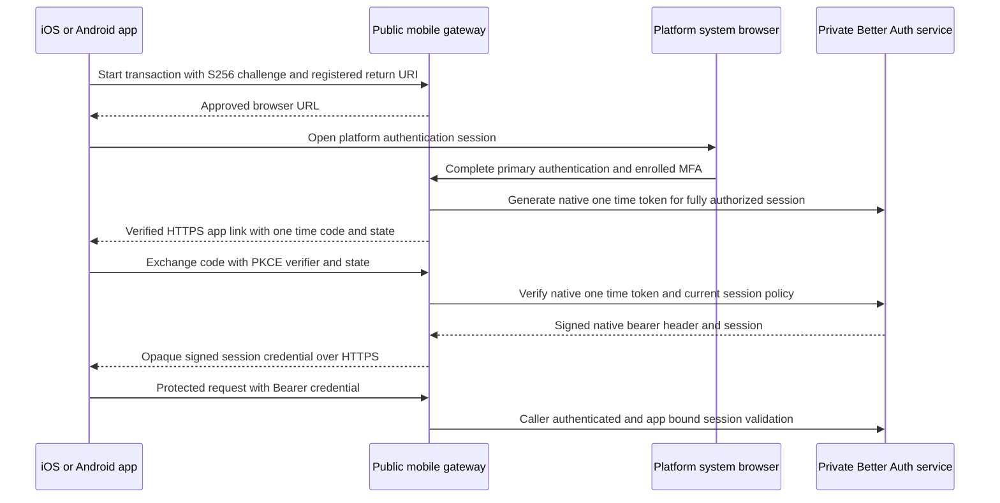

# Native Mobile Authentication

Release classification: mandatory first-release integration for web, iOS, and Android. Last reviewed: 2026-10-15.

[Documentation index](../README.md) · [Application integration](../13-application-and-service-integration/README.md) · [Sessions](../07-session-management/README.md) · [MFA](../09-multi-factor-authentication/README.md)

This is a separate implementation task following the shared application-integration contract in phase 13. Its foundational provisioning is read during M1; complete mobile delivery and acceptance are required for M5. Verification is consolidated in [15](../15-testing-strategy/README.md), and launch requirements are in [16](../16-deployment-and-operations/README.md).

## Objective and scope

Authenticate browser and native iOS/Android clients against the same identities, application memberships, native sessions, and security policies. Mobile support is required for the first release, not a future extension. Native desktop remains deferred.

The mobile contract is framework-neutral. Native Swift/Kotlin, Flutter, React Native, and other HTTP-capable applications can implement it without a mandatory client SDK. This task specifies backend and client integration; it does not add a mobile application or authentication UI to the repository.

Every first-release authentication method is available to mobile users through a hosted first-party authentication page opened in the platform system browser: email/username/password, verification/recovery, magic links, email OTP, Google, passkeys, enterprise OIDC/SAML, and required TOTP/recovery. A mobile application need not implement its own WebAuthn or embedded-provider UI. Fully native credential/provider SDK screens are optional later presentation improvements, not prerequisites for mobile authentication.

## Architecture and design

### Transport and trust boundaries

| Client | Authentication interaction | Protected API credential |
| --- | --- | --- |
| Web | Same-origin BFF, existing native HTTP routes, browser cookies and CSRF | Host-only Secure/HttpOnly native session cookie |
| Native iOS/Android | Public mobile gateway starts a browser login; complete all required factors in ASWebAuthenticationSession or Android Custom Tabs | Native signed opaque session token in `Authorization: Bearer ...`, stored in Keychain/Keystore-backed encrypted storage |

The mobile application is a public client. Its application identifier, bundle/package name, signing-certificate fingerprint, and return URI are registration metadata, not client secrets or proof that a request came from an untampered binary. Never embed a BFF/API/service key, SMTP secret, OAuth client secret, or auth signing key in the application. Optional attestation can strengthen abuse controls later; it does not replace human authentication.

The mobile gateway exposes only the routes in this document and the registered mobile application's approved resource proxy. It retains a server-side application-bound service key for calls into the private identity backend. Existing BFF/backend caller authentication remains mandatory on that private boundary. Do not expose `/internal/v1/*` or raw native management/token-transfer routes to devices.

Register a mobile authentication origin such as `https://mobile-one.apps.example.com` and an exact verified HTTPS return URI such as `https://links.example.com/one/auth/complete`. Example values are placeholders. The authentication origin remains an approved child of the shared WebAuthn RP, so the system browser uses the same verified RP/origin controls. Return-link ownership is separately established through iOS Universal Links/Associated Domains and Android App Links/Digital Asset Links, including package/signing identity. Arbitrary return URLs, custom-scheme fallback, wildcard redirects, and embedded WebViews are not first-release paths.

### Mobile login and session handoff

1. The device generates a cryptographically random OAuth-style state and a PKCE verifier (43–128 allowed characters) in memory or short-lived secure storage. Compute the S256 challenge. Start an authentication transaction using the registered public application ID and exact return URI.
2. The gateway validates the active mobile registration, rate limits, return URI, platform, and challenge format. Persist a ten-minute transaction and return its HTTPS browser URL. The identifier alone grants no session or account access.
3. Open that URL in the platform system browser. The gateway binds the transaction to a fresh host-only browser-correlation cookie and applies the existing BFF/CSRF/native route policy. Do not accept an arbitrary existing cookie as fresh primary proof: require a new primary sign-in for this transaction and the enrolled factor when required.
4. Perform the selected native authentication and any registration/recovery/setup flow on the hosted page. Apply exact app membership, account lifecycle, bootstrap, native freshness, and all-method MFA gates. Browser callbacks stay on the approved HTTPS authentication origin. SAML retains its separate transient browser-correlation defense.
5. An explicit browser completion POST, protected by CSRF and the transaction cookie, checks the actual native session and full current assurance. Bind the transaction to that session and invoke the native server-only one-time-token generator. Store only an HMAC of that token in the transaction; no raw session credential goes into a redirect.
6. Redirect to the exact verified return link with `transactionId`, short-lived one-time `code`, and the original client state. This code is a native session-transfer artifact, not an OAuth authorization-server grant or reusable session token. Use no-store/no-referrer and no third-party assets/analytics on link handling. The device rejects a missing/mismatched state or unexpected link.
7. The device sends the code, transaction ID, original state, and PKCE verifier to the gateway exchange endpoint. Before native token consumption, atomically fence the transaction and check expiry, return/application binding, state hash, code HMAC, and S256(verifier). A stolen code without the verifier must not consume a legitimate native token or disclose a session.
8. Through the trusted server API, consume the native one-time token. Resolve and recheck its associated live session against the transaction/application and current assurance. The native bearer after-hook supplies its signed cookie-equivalent token through `set-auth-token`; return that value as the mobile session credential. Do not sign a replacement token or substitute the raw unsigned `session.token` field.
9. Mark completion, remove temporary browser/app state, and retain only short-lived redacted transaction metadata. Store the signed token in platform secure storage. The device uses it for requests to its approved mobile gateway; the gateway injects its own backend service credential and retains app/permission/MFA checks.

The bearer value refers to the same database-backed session established in the browser. It is neither a stateless JWT nor a separate access/refresh-token pair. Exchange does not reset expiry, MFA freshness, security epoch, original provider identity, or application membership. Logout/revocation and provider/app disablement affect its next authoritative check exactly as on web.

### Native plugin configuration and integration

Use the bundled Better Auth bearer and one-time-token plugins from the selected pinned release. Source-inspected v1.7.8 settings are `bearer.requireSignature=true` and one-time-token `disableClientRequest=true`, `storeToken="hashed"`, `expiresIn=1` (minutes), `disableSetSessionCookie=false`, and `setOttHeaderOnNewSession=false`.

Keep raw `/api/auth/one-time-token/generate` and `/api/auth/one-time-token/verify` HTTP routes denied. Only guarded gateway server operations invoke their typed APIs. Cookie emission during typed verification allows the native bearer after-hook to expose the signed token; capture headers using the supported native server response-header API and verify this ordering during implementation. Do not send these exchange cookies to the device as ambient browser authentication.

`@thallesp/nestjs-better-auth` is the selected Nest integration layer. Initialize its AuthModule from the async configured native instance, reuse its AuthService/guard/decorators, and compose the service's stronger application/assurance policy around it. A library session guard does not validate PKCE, return-link binding, mobile transaction state, application membership, or all-method MFA by itself.

Web proxies strip bearer-export headers such as `set-auth-token` from browser-facing responses. Mobile gateways return that secret only in the authenticated exchange response body over HTTPS. Never expose it in a URL, push notification, log, metric, exception, screenshot/analytics payload, or browser local storage.

## Dependencies and prerequisites

M1 includes mobile registration, gateway caller provisioning, exact host/return URI configuration, and transaction storage. M2 includes bearer-aware native session resolution. M3/M4 supply the same factor, provider, and hosted-browser methods used on web. M5 includes real iOS and Android acceptance before release.

Client prerequisites are platform system-browser authentication, cryptographic random generation and SHA-256 for PKCE, verified HTTPS application links, and Keychain/Keystore-backed storage. The optional Expo adapter is not required for this framework-neutral contract and must not be added solely to enable a generic mobile client.

## Database design

Use `identity.mobile_clients` and `identity.mobile_auth_transactions` defined in phase 03. Register `allowed_transports` on applications; a mobile registration explicitly permits bearer transport and its hosted browser flow. Native session, challenge, factor, and one-time-token records remain in `auth`.

Each transaction stores its application, exact return URI, platform, S256 challenge, state comparison hash, encrypted client-state echo with IV/tag/key ID, optional browser-binding HMAC, native session reference, one-time-token HMAC, version, expiry, and state. States are pending, browser_verified, code_issued, exchanging, completed, failed, or expired. Store no PKCE verifier, reusable bearer credential, raw one-time code, password, or copied native challenge. A native session reference is an opaque ID, not its secret token. The encrypted echo is limited to this transaction's return flow and purged at completion/expiry; the native client retains its original state independently for comparison.

The native token and TypeORM transaction do not share a database transaction. Use an exclusive transaction/lease to reserve exchange before invoking native consumption, and require a matching version/owner to finalize. If consumption succeeds but gateway completion/delivery fails, remain failed/restricted and require a new login; never replay or persist a reusable bearer response for recovery. Concurrent exchanges have at most one successful token delivery. A timed-out request is not automatically retried with the same code.

The login transaction expires after ten minutes, while an issued native handoff code expires after one minute or the remaining transaction lifetime, whichever is shorter. Enforce both bounds independently. Cleanup expires stale transactions and purges code/browser-binding HMACs on completion or terminal failure; retain only redacted completion metadata for at most 24 hours. Underlying native session expiry is unchanged.

## API contracts

The gateway paths below are proposed service interfaces, not Better Auth endpoints. They use the custom envelopes/errors from phase 02. Public means no embedded service secret; it never waives input, rate, transaction, proof, or account checks. All responses are no-store.

| Method and public gateway path | Input and caller | Success | Failure and effects |
| --- | --- | --- | --- |
| POST `/mobile/v1/auth/transactions` | Native public client: `applicationId`, `platform: ios|android`, exact `returnUri`, `codeChallenge`, `codeChallengeMethod: S256`, random `state` | 201 `{transactionId,browserUrl,expiresAt}` | 400 malformed/unregistered destination, 403 inactive app/client, 429 budget; creates no user session; audit transaction start without state/verifier |
| GET `/mobile/auth/start` | System browser: `transactionId`; gateway-bound browser context | 200 hosted login page and temporary browser binding | Expired/missing transaction denied; no automatic credential success; suppress external referrers |
| POST `/mobile/v1/auth/complete` | Browser native cookie, CSRF token, transaction/browser binding; body `transactionId` | 303 to exact registered HTTPS app link with code/state | 401 missing native session; 403 pending MFA/bootstrap/app access; 409 completion already used; no handoff before all gates |
| POST `/mobile/v1/auth/exchange` | Native public client: `transactionId`, `code`, `state`, `codeVerifier`; no browser cookies or service key | 200 `{tokenType: Bearer,sessionToken,expiresAt,user:UserView}` | 400 invalid proof, 409 used/reserved transaction, 410 expired flow, 429 budget, 503 native/policy failure; atomic native code consumption and redacted audit |

Preserve the client state only as long as needed for the completion redirect. Store its comparison hash and a separate encrypted echo with a versioned external key, then purge the echo at completion/expiry. Never store raw state in an unprotected metadata field. The public transaction identifier does not replace verification of the client's original random state.

For resource calls, the mobile client sends `Authorization: Bearer <signed native session value>` to its gateway's approved `/api/v1/*` proxy. The gateway rejects mixed ambient session cookies and bearer input, strips spoofed service/forwarding headers, and forwards the bearer plus its server-held application credential. Internal validation/check accepts exactly one of `cookieHeader` for web or `bearerToken` for mobile, as described in the integration README. The core resolver invokes native `getSession` with the appropriate trusted headers before applying the common identity policy.

Native authentication initiation/redemption remains browser-hosted under the existing `/api/auth/*` allowlist; the device does not call a raw privileged native token endpoint. Native sign-out can be called through a guarded mobile logout proxy with the bearer header: durably invalidate assurance, invoke native sign-out, then erase secure local credentials even when a network failure must be reported. Do not falsely claim confirmed server revocation while offline; an online device-management action can revoke the session from another trusted client.

## Security considerations

Use PKCE S256 and verified HTTPS links as separate controls. Code/state/transaction checks must run before the one-time-token verifier consumes anything. Bound invalid-exchange attempts to five per transaction, with 20 exchange attempts/minute/IP; bound starts to 10/minute/IP and 30/15 minutes/application/IP. Apply shared multi-instance counters, gateway body limits, anti-enumeration, and native method budgets. Transaction creation is not proof of app authenticity.

Browser cookies retain CSRF/origin protections, including SAML exceptions; native bearer resource requests follow the explicit mobile gateway policy without inventing a browser Origin. An absent Origin or forged mobile header does not make a web cookie request trusted. Protect public transaction start/exchange endpoints by their declared proof and registration rules rather than embedding a secret or globally disabling Better Auth checks.

Do not use embedded WebViews for password/provider/passkey entry. After return, compare the expected host/path, state, and transaction before exchanging. Store device credentials in secure platform storage, exclude them from cloud/device backups where the platform permits, and clear them on logout/account removal. A cached profile is display-only: revalidate online on foreground/resume and before protected operations; no offline authorization or indefinite authenticated success cache.

## Implementation plan

1. Provision exact mobile registrations, approved authentication origins, verified app-link associations, server-only gateway keys, and shared transaction/counter storage during M1.
2. Enable the pinned native bearer/OTT plugins and typed session resolution through the chosen Nest integration library; keep raw transfer endpoints denied.
3. Implement gateway transaction initiation and browser binding, and a hosted UI integration contract covering every required authentication method and factor.
4. Implement guarded native OTT generation, exact return-link construction, PKCE/state validation, transaction fencing, native consumption, and secret-only HTTPS response delivery.
5. Add secure-storage/logout/resume contracts and common account/session/device revocation across web and mobile.
6. Verify platform link ownership, callback behavior, native header ordering, concurrency, expiry, MFA parity, and loss/revocation scenarios on real iOS and Android before M5.

## Acceptance criteria

- MOB-01: Both iOS and Android complete every supported primary method through the system browser, including enrollment/recovery and the required local second factor.
- MOB-02: No mobile bundle or request needs a server/service key; gateway public-client identifiers cannot confer a human identity or bypass app policy.
- MOB-03: Missing/wrong PKCE, state, app, transaction, browser binding, return URI, or verified-link association denies handoff without leaking a reusable session credential.
- MOB-04: Native OTT is hashed, server-generated only, one-minute bounded, and atomically single use; concurrent exchange delivers at most one usable bearer response.
- MOB-05: Pending MFA/bootstrap, disabled account/app/provider, stale epoch, expired session, and failed policy storage prevent both generation and exchange.
- MOB-06: Device tokens are signed native opaque sessions, stored in platform secure storage, absent from URLs/logs, and resolved through the same authoritative session policy as browser cookies.
- MOB-07: Logout, device-session revocation, account recovery, membership removal and security-policy changes deny the next mobile request just as they deny web requests.
- MOB-08: Browser/native credential mixing, cross-app replay, lost exchange response, interrupted browser flow, killed/resumed app, cold-start link handling, and unavailable dependencies have fail-closed recovery behavior with no saved secret response replay.

## Official references

- [Better Auth bearer plugin](https://better-auth.com/docs/plugins/bearer) and [v1.7.8 implementation](https://github.com/better-auth/better-auth/blob/v1.7.8/packages/better-auth/src/plugins/bearer/index.ts)
- [Better Auth one-time-token plugin](https://better-auth.com/docs/plugins/one-time-token) and [v1.7.8 implementation](https://github.com/better-auth/better-auth/blob/v1.7.8/packages/better-auth/src/plugins/one-time-token/index.ts)
- [Nest integration library](https://github.com/thallesp/nestjs-better-auth)
- [PKCE specification](https://www.rfc-editor.org/rfc/rfc7636)
- [OAuth security for native applications](https://www.rfc-editor.org/rfc/rfc8252)
- [Apple web authentication sessions](https://developer.apple.com/documentation/authenticationservices/aswebauthenticationsession)
- [Apple associated domains](https://developer.apple.com/documentation/xcode/supporting-associated-domains)
- [Android App Links](https://developer.android.com/training/app-links)
- [Android Custom Tabs](https://developer.chrome.com/docs/android/custom-tabs)

Source inspection establishes the planned contract, not completed mobile/browser compatibility. Real-platform evidence is a mandatory first-release gate.
