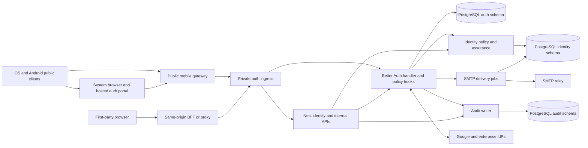

# Authentication and Identity Service

Status: proposed architecture and implementation specification. Last reviewed: 2026-10-15.

This documentation defines how to turn the existing NestJS scaffold into a reusable HTTP authentication and identity service. It is intended for the engineer or coding agent implementing the service. Nothing described as planned is implemented merely because it appears here.

The first release requires web and native mobile (iOS and Android) authentication with every feature in the repository README: email and username/password, Google OAuth, two-factor authentication, magic links, email OTP, passkeys, enterprise SSO, account management, session management, and SuperAdmin bootstrap. These are delivered through smaller milestones; the first milestone is not the complete release. Native desktop remains future work.

## Architecture

Use NestJS 11 with its Express adapter, `@thallesp/nestjs-better-auth` as the selected Nest integration layer, Better Auth with the supported PostgreSQL integration, and TypeORM for service-owned data. The integration library owns the single native handler and provides AuthModule/AuthService, session guards and decorators; compose service policy around those capabilities. Better Auth owns credentials, challenges, native sessions, federation, and authentication plugin tables. Nest owns application access, server-side MFA assurance, administrative orchestration, SMTP delivery, audit policy, and operational endpoints.

Use one shared identity realm and explicitly approved first-party applications. Each web application proxies authentication under its own origin and receives host-only cookies. Mobile apps authenticate through a hosted first-party portal in the system browser, then exchange a PKCE-bound one-time handoff through the public gateway for a signed opaque bearer session stored in Keychain/Keystore. The gateway holds the private backend credential; it is never embedded in the app. All methods and MFA use the same identity and policy authority. See the required [mobile authentication contract](14-mobile-authentication/README.md).

A shared user record does not grant access to every application. Enterprise SSO means accepting external OIDC and SAML identity providers; operating an OAuth/OIDC authorization server is deferred.

## Reading and implementation order

| Order | Document | Main exit condition |
| --- | --- | --- |
| 00 | [Project overview](00-project-overview/README.md) | Boundaries, decisions, and current-state gaps understood |
| 01 | [Dependencies and compatibility](01-dependencies-and-compatibility/README.md) | Runtime, package, and module-format baseline agreed |
| 02 | [Common infrastructure](02-common-infrastructure/README.md) | Configuration, HTTP conventions, and composition ready |
| 03 | [Database and persistence](03-database-and-persistence/README.md) | Three schemas and one migration sequence ready |
| 04 | [Security and audit foundations](04-security-and-audit-foundations/README.md) | Ingress, abuse controls, policy hooks, and audit ready |
| 05 | [SMTP delivery](05-smtp-delivery/README.md) | Expiring challenges can be delivered safely |
| 06 | [Authentication and lifecycle](06-authentication-and-account-lifecycle/README.md) | Registration, credentials, verification, and recovery complete |
| 07 | [Sessions](07-session-management/README.md) | Session lookup, renewal, and revocation complete |
| 08 | [Authorization and bootstrap](08-authorization-and-bootstrap/README.md) | Application access and safe SuperAdmin bootstrap complete |
| 09 | [MFA](09-multi-factor-authentication/README.md) | Every enabled sign-in method obeys assurance policy |
| 10 | [Passwordless authentication](10-passwordless-authentication/README.md) | Magic links and email OTP complete |
| 11 | [Google and passkeys](11-social-authentication-and-passkeys/README.md) | Provider callbacks and WebAuthn complete |
| 12 | [Enterprise SSO](12-enterprise-sso/README.md) | OIDC and SAML trust and callbacks complete |
| 13 | [Application and service integration](13-application-and-service-integration/README.md) | Web BFF, application identity, and backend contracts complete |
| 14 | [Mobile authentication](14-mobile-authentication/README.md) | iOS/Android gateway, browser sign-in, secure handoff, device storage, and session lifecycle complete |
| 15 | [Testing strategy](15-testing-strategy/README.md) | Required verification evidence specified |
| 16 | [Deployment and operations](16-deployment-and-operations/README.md) | Launch, recovery, and rollback gates met |
| 17 | [Future enhancements](17-future-enhancements/README.md) | Deferred capabilities remain separate from release one |

The test strategy is read before implementation and used at every milestone. The deployment requirements inform infrastructure choices from the beginning. Folder numbering describes primary implementation order, not a reason to defer security or verification until the end.

## Feature ownership and requirement traceability

| Requirement | Better Auth responsibility | Custom service responsibility | Specification and acceptance IDs |
| --- | --- | --- | --- |
| Email and username/password | Core credentials; username plugin | Verification policy, input boundaries | 06: AUTH-01 through AUTH-06 |
| Verification and recovery | Core tokens and account changes | SMTP callbacks, safe redirects, revocation policy | 05: MAIL-01 through MAIL-06; 06: AUTH-03 through AUTH-08 |
| Google OAuth | Google social provider | Provider registration, application binding, MFA gate | 11: EXT-01 through EXT-04 |
| 2FA | TOTP enrollment, verification, backup codes | All-method assurance, throttling, privileged policy | 09: MFA-01 through MFA-10 |
| Magic links and email OTP | Native plugins and verification storage | Delivery, anti-abuse, MFA gate | 10: PWL-01 through PWL-07 |
| Passkeys | Passkey plugin | RP/origin policy, recovery, MFA gate | 11: EXT-05 through EXT-09 |
| Enterprise SSO | SSO plugin acting as RP/SP | Provider trust administration and application restrictions | 12: SSO-01 through SSO-09 |
| Account management | User/account APIs and admin plugin | Application membership, deletion orchestration | 06: AUTH-07 through AUTH-09; 08: AZ-01 through AZ-08 |
| Session management | Database sessions and native revocation | Token-free device views, assurance, backend validation | 07: SES-01 through SES-08 |
| SuperAdmin command | Server-side user and admin APIs | Idempotent bootstrap, secure output, required enrollment | 08: AZ-06 through AZ-08 |
| Reusable HTTP integration | Native auth HTTP handler | BFF identity, application access, internal contracts | 13: INT-01 through INT-08 |
| Web and iOS/Android authentication | Native bearer and one-time-token plugins; existing authentication methods | Public gateway, hosted browser flow, PKCE-bound app-link handoff, secure device storage, application policy | 14: [MOB-01 through MOB-08](14-mobile-authentication/README.md#acceptance-criteria) |
| SMTP without mail SDK/framework | Email callbacks only | Nodemailer SMTP transport and owned message content | 05: MAIL-01 through MAIL-06 |
| Dedicated database schemas | Supported PostgreSQL schema selection | Grants, schema-qualified TypeORM records, migration ownership | 03: DB-01 through DB-08 |

Acceptance IDs are local to the linked numbered document. Detailed future verification scenarios are consolidated in [15](15-testing-strategy/README.md).

## Master roadmap

| Milestone | Dependencies and deliverables | Promotion gate |
| --- | --- | --- |
| M0 Architecture baseline | 00 and 01; inventory current source, choose pinned compatible packages | Package and route evidence recorded; no claim of runtime verification |
| M1 Foundations | M0; 02 through 05 plus initial application/BFF/mobile-gateway provisioning and ingress from 13 and 14; composition, schemas, security, audit, SMTP | Public-client/gateway and private-backend trust boundaries configured; configuration, schema grants, and mail failure behavior verified later |
| M2 Core identity | M1; 06 and 07 plus native signed bearer and one-time-token integration | Verified credential login, recovery, cookie/bearer session revocation, and native response preservation |
| M3 Administration and MFA | M2; 08 and 09 | Safe bootstrap, access boundaries, and all-method assurance enforcement |
| M4 Complete README authentication | M3; 10 through 12 and hosted mobile authentication portal | Every method, including password, OTP, magic links, Google, passkeys, OIDC, and SAML, works in the hosted system-browser flow and passes MFA policy |
| M5 Integration and launch | M4; application integration in 13, mobile authentication in 14, operations in 16, and evidence from 15 | Real iOS and Android handoff, secure storage, replay/PKCE rejection, renewal and revocation; web parity; restore drill, rotation, rollback, and limited rollout complete |

M2 and M3 are development milestones. They do not satisfy the user's complete first-release feature scope. Read and implement the minimal operator provisioning/ingress subsets of 13 and 14 during M1; their complete integration tasks remain M5. This avoids needing an already authenticated user to provision the first BFF or gateway. Mobile authentication is a separate task with the objective, dependencies, API/data contracts, implementation steps, and acceptance criteria in folder 14. Production security, monitoring, migration review, backup/restore, and MFA bypass coverage are mandatory launch gates.

Production enhancements after launch include distributed abuse storage, delivery workers deployed separately, richer detection, and tuned telemetry. Optional future capabilities include organizations, isolated tenant realms, native desktop authentication, SCIM, and an OAuth/OIDC provider. Web and native mobile authentication must not be deferred from the first-release contract.

## Locked decisions and working defaults

- The deliverables are Markdown only. The selected System Design template supplies the overview structure; its retained DOCX is unchanged.
- PostgreSQL schemas are `auth`, `identity`, and `audit`. Runtime processes cannot create schemas or tables.
- Authentication uses database-backed opaque sessions. Cookie caching and authentication secondary storage are disabled initially; Redis is not required for the first release.
- Web cookie sessions and mobile signed opaque bearer sessions share Better Auth's database-backed session authority; no parallel JWT/refresh-token pair is introduced. Native mobile is a public client. A server-held service key authenticates its gateway to the private backend.
- Every mobile method uses the first-party hosted portal in ASWebAuthenticationSession/Android Custom Tabs. After complete MFA assurance, transfer the native session using a hashed one-time token with a one-minute lifetime, a PKCE S256-bound gateway transaction, and verified HTTPS Universal Links/App Links; never place a raw session token in a URL. Detailed contracts live in 13.
- Email uses Nodemailer as an SMTP transport library only. No provider SDK, Nest mailer framework, hosted email API, or email framework is introduced.
- MFA-enabled users must present TOTP or a recovery code after every sign-in method. Neither Google/SSO authentication nor a passkey automatically substitutes for that enrolled factor.
- First-party production hosts are exact allowlisted hosts within one controlled parent domain for a shared WebAuthn RP. Example domains throughout these documents are placeholders, not deployment claims.
- No production workload, region, team owner, or regulatory retention obligation was supplied. Operational targets and retention periods are explicit engineering defaults to confirm before launch.
- Runtime compatibility, migrations, external provider behavior, and test outcomes remain unverified until the later implementation work executes the documented checks.

## How to implement a phase

Read its prerequisites and linked shared contracts. Implement only its stated application work in a later coding task. Follow the numbered implementation steps, collect acceptance evidence, update the milestone status, and preserve earlier invariants. Do not add a second credential store, challenge service, session issuer, or authorization server to compensate for a misunderstood plugin boundary.

During this documentation task, no application implementation, package installation, builds, lint checks, or tests are authorized. Do not create `.pnpm-store`, logs, temporary scripts, render output, or caches in the repository.

## Primary references

- [Better Auth documentation](https://better-auth.com/docs/introduction)
- [NestJS documentation](https://docs.nestjs.com/)
- [Selected Nest Better Auth integration](https://github.com/thallesp/nestjs-better-auth)
- [Better Auth v1.7.8 source](https://github.com/better-auth/better-auth/tree/v1.7.8), used to resolve version-specific contracts
- [PostgreSQL schemas](https://www.postgresql.org/docs/current/ddl-schemas.html)
- [Better Auth bearer sessions](https://better-auth.com/docs/plugins/bearer)
- [Better Auth one-time tokens](https://better-auth.com/docs/plugins/one-time-token)

Feature documents link their own technical sources. Product documentation can change; recheck versioned source before adopting a different package version.
